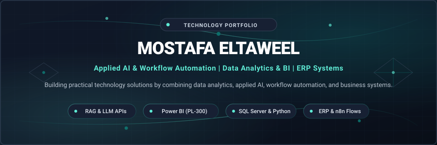

<div align="center">



# Hi, I'm Mostafa Eltaweel 👋

### **Applied AI & Workflow Automation | Data Analytics & BI | ERP Systems**

*"Building practical technology solutions by combining data analytics, applied AI, workflow automation, and business systems."*

[](https://mostafaeltaweel.github.io/mostafa-eltaweel-portfolio/)
[](https://linkedin.com/in/mostafa-eltaweel)
[](https://learn.microsoft.com/en-us/users/mostafamohamedeltaweel-0210/credentials/b5d4c2c72a13d32)
[](mailto:mostafa.eltaweel000@gmail.com)

</div>

---

## 📌 About Me

I am a technology practitioner working across **ERP business operations**, **data analytics**, and **applied AI engineering**. 

My background began in **enterprise ERP technical support** at DewanSoft, where I investigated daily operational friction across invoicing, tax submission portals, data synchronization, and user permissions. To turn operational data into proactive business intelligence, I completed intensive specialized training with **Digilians (MTC & MCIT)** and earned certified credentials including the **Microsoft Certified: Power BI Data Analyst Associate (PL-300)**.

Today, I combine **legal-grade critical logic** (from my background at Cairo University Faculty of Law) with modern engineering tools—designing **production Star-Schema BI models**, **SQL databases**, and **autonomous AI workflow agents (RAG, n8n, LangChain)** that solve tangible business problems.

---

## 🎯 Core Focus Areas

```
┌───────────────────────────────────────┬───────────────────────────────────────┬───────────────────────────────────────┐
│ 🤖 Applied AI & Automation            │ 📊 Data Analytics & BI                │ 🏢 ERP & Business Workflows           │
├───────────────────────────────────────┼───────────────────────────────────────┼───────────────────────────────────────┤
│ • Retrieval-Augmented Generation(RAG) │ • Microsoft Power BI (PL-300 Certified)│ • ERP Interface & Case Investigation  │
│ • Agentic Workflows (n8n, LangChain)  │ • Star-Schema Dimensional Modeling    │ • Commercial Invoicing & Tax Portals  │
│ • LLM APIs (Groq, Llama 3, Gemini)    │ • Advanced DAX & Financial KPIs       │ • User Roles & Permissions Management │
│ • Webhooks & Multi-Platform Pipelines │ • SQL Server, CTEs, Joins & ERD Design │ • Change Request (CR) Documentation   │
└───────────────────────────────────────┴───────────────────────────────────────┴───────────────────────────────────────┘
```

---

## 🛠️ Technical Stack & Tools

### Programming & AI Engineering


### Business Intelligence & Analytics
-101827?style=flat-square&logo=powerbi&logoColor=5EEAD4)


### Databases & Automation Systems


---

## 🚀 Featured Technical Projects

### 1. [Hotel Booking Cancellation Diagnostics & AI Analytics](https://github.com/mostafaeltaweel/hotel-booking-analytics)
*Diagnostic Analytics, LangChain Agent & Power BI Walkthrough*
- **Business Problem:** High cancellation volatility eroded hotel net revenue; management required root-cause visibility into lead-time exposure and ADR pricing elasticity.
- **Data & Method:** Audited **119,390 raw booking records**. Engineered analytical pipelines calculating monthly ADR variance, lead-time risk bins, and cancellation percentages. Integrated a LangChain exploratory agent powered by Gemini for conversational table interrogation.
- **Key Findings:** Pinpointed cancellation spike past 90-day lead windows; identified optimal deposit policy adjustments to protect booking yield.
- **Tech Stack:** Python 3.12, Pandas, LangChain Agent, Power BI, SQL Queries.
- **Links:** [Repository](https://github.com/mostafaeltaweel/hotel-booking-analytics) · [Live Portfolio Demo](https://mostafaeltaweel.github.io/mostafa-eltaweel-portfolio/)

### 2. [Autonomous AI Lead Qualification & CRM Automation](https://github.com/mostafaeltaweel/ai-lead-qualification-agent)
*Enterprise Multi-Agent Workflow Pipeline with n8n & Groq LLM*
- **Business Problem:** Inbound sales leads experienced 12–24h response latency, resulting in lead drop-off and unstandardized qualification notes.
- **Architecture:** Engineered a 4-stage automated pipeline connecting **Telegram Assistant**, **Form Intake**, and **Gmail Triage** to an LLM evaluator (Groq Llama 3) that extracts budget, timeline, and urgency into structured JSON schemas, appending qualified records into a Google Sheets CRM.
- **Results:** Achieved sub-60-second lead evaluation with 100% schema validation and automatic stakeholder email alerting.
- **Tech Stack:** n8n, Groq API (Llama 3), Webhooks, JSON Schema, REST APIs, Google Sheets CRM.
- **Links:** [Repository](https://github.com/mostafaeltaweel/ai-lead-qualification-agent) · [System Documentation](https://github.com/mostafaeltaweel/ai-lead-qualification-agent/blob/main/README.md)

### 3. [Sales & Financial Performance BI Dashboard](https://github.com/mostafaeltaweel/sales-financial-bi-audit)
*Star-Schema Data Modeling, Power Query ETL & Executive KPIs*
- **Business Problem:** Disconnected transaction ledgers obscured net profitability, return rates, and regional salesperson quota attainment.
- **Implementation:** Structured raw transactional ledgers into a normalized **Star-Schema model** (Sales Fact connected to Customer, Product, and Date dimensions). Authored DAX measures for Gross Sales, COGS, Net Revenue, Gross Margin %, and Target Variance %.
- **Results:** Eliminated reporting calculation discrepancies and reduced monthly executive reporting prep from 4 days to real-time.
- **Tech Stack:** Power BI Desktop, DAX Time Intelligence, Power Query (M), Data Modeling.
- **Links:** [Repository](https://github.com/mostafaeltaweel/sales-financial-bi-audit) · [PBIX Model](https://mostafaeltaweel.github.io/mostafa-eltaweel-portfolio/)

### 4. [Hospitality Enterprise Database Architecture & ERD](https://github.com/mostafaeltaweel/hospitality-erp-database)
*Normalized Relational Schema & SQL Server Implementation*
- **Business Problem:** Enterprise hospitality booking software required a robust relational database schema to eliminate double-booking anomalies and preserve financial transaction history.
- **Implementation:** Designed a 3NF normalized schema covering Guest Profiles, Room Inventories, Reservations, Folio Transactions, and Payment Invoices. Authored SQL constraints, foreign keys, indexing strategies, and analytical reporting views.
- **Tech Stack:** Microsoft SQL Server, T-SQL, Database Architecture, ERD Design.
- **Links:** [Repository](https://github.com/mostafaeltaweel/hospitality-erp-database)

---

## 💼 Professional Experience & Specialized Learning

| Organization / Initiative | Role / Focus | Period | Core Responsibilities & Impact |
| :--- | :--- | :--- | :--- |
| **ITechPro-eg** | Applied AI Engineer Intern | Sep 2026 – Present | Rapid prototyping with Generative AI tools, structuring prompt schemas, automating data workflows, and validating model outputs against commercial requirements. |
| **Digilians (الرواد الرقميون)** | Applied AI & Data Analysis Specialist | Oct 2025 – Aug 2026 *(11 mos)* | Intensive training by MCIT & Military Technical College covering end-to-end data cleaning, SQL database querying, Power BI modeling, and machine learning capstones. |
| **DewanSoft** | ERP Technical Support Specialist | Jan 2025 – Sep 2025 *(9 mos)* | Supported business users across ERP operations, handling 10–20 daily cases involving commercial transactions, invoicing discrepancies, tax portal submissions, and Change Request (CR) documentation. |
| **Faculty of Law — Cairo University** | Bachelor of Laws (LL.B.) | Sep 2019 – Jul 2022 | Trained in formal evidence evaluation, eliminating bias, and statutory compliance—methodologies directly transferred to data validation and system auditability. |

---

## 📜 Verified Certifications & Credentials

- **[Microsoft Certified: Power BI Data Analyst Associate (PL-300)](https://learn.microsoft.com/en-us/users/mostafamohamedeltaweel-0210/credentials/b5d4c2c72a13d32)** — Official Microsoft Credential
- **[Google Data Analytics Professional Certificate](https://www.coursera.org/account/accomplishments/professional-cert/XMKR1FA09WQD)** — Coursera Verified
- **[IBM Machine Learning with Python](https://www.coursera.org/account/accomplishments/verify/2UABLVCGZBDC)** — Coursera Verified
- **[Applied AI & Data Analysis Professional Diploma](https://mostafaeltaweel.github.io/mostafa-eltaweel-portfolio/)** — Digilians (MCIT & Military Technical College)
- **McKinsey Forward Program** — McKinsey & Company (Structured Problem Solving & Business Communication)

---

## 📈 GitHub Activity

<div align="center">


&nbsp;


</div>

---

## 📬 Connect With Me

- 🌐 **Live Portfolio:** [mostafaeltaweel.github.io/mostafa-eltaweel-portfolio](https://mostafaeltaweel.github.io/mostafa-eltaweel-portfolio/)
- 💼 **LinkedIn:** [linkedin.com/in/mostafa-eltaweel](https://linkedin.com/in/mostafa-eltaweel)
- 🐙 **GitHub:** [github.com/mostafaeltaweel](https://github.com/mostafaeltaweel)
- 📧 **Email:** [mostafa.eltaweel000@gmail.com](mailto:mostafa.eltaweel000@gmail.com)
- 💬 **WhatsApp:** [+20 111 261 1898](https://wa.me/201112611898)

---
<div align="center">
  <sub>Designed with precision · Deep Navy &amp; Teal System · Updated October 2026</sub>
</div>